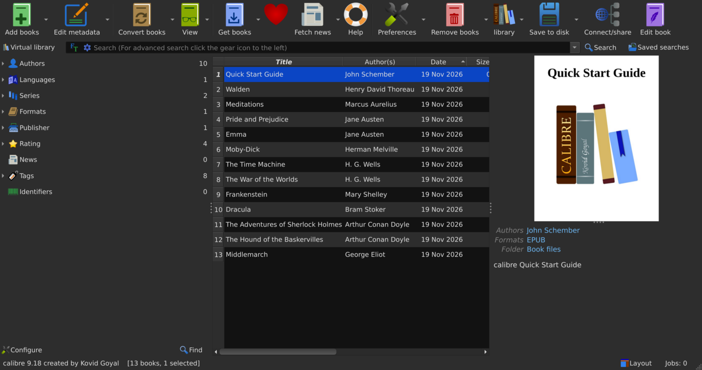
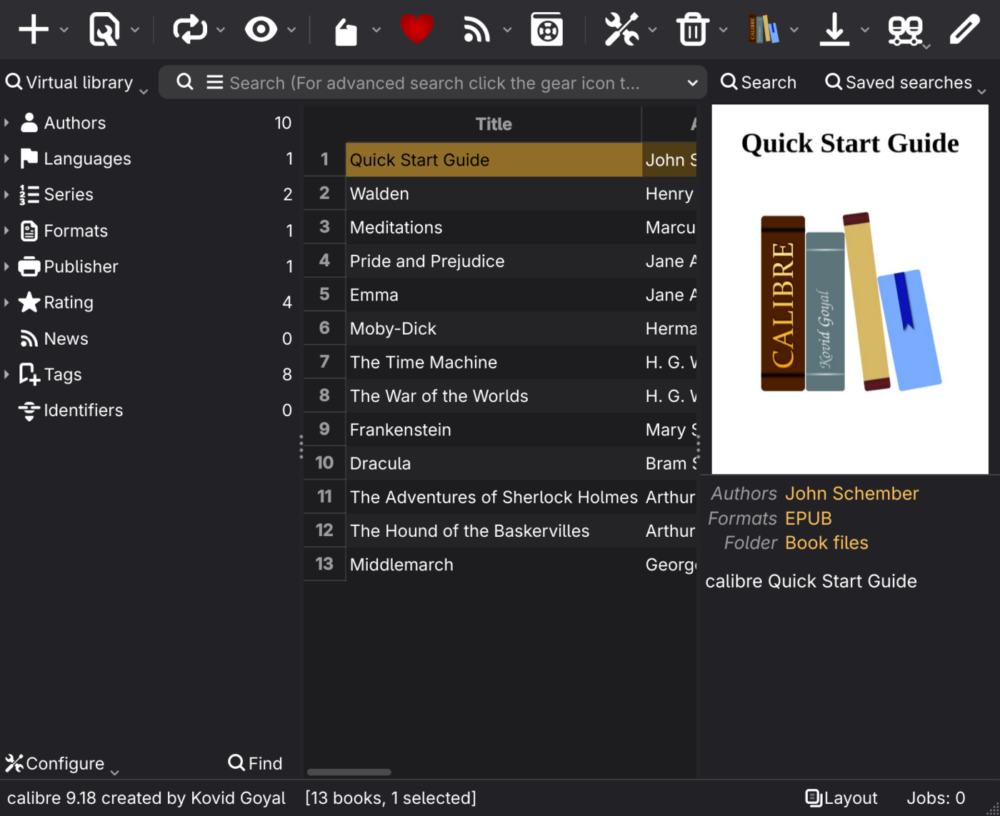
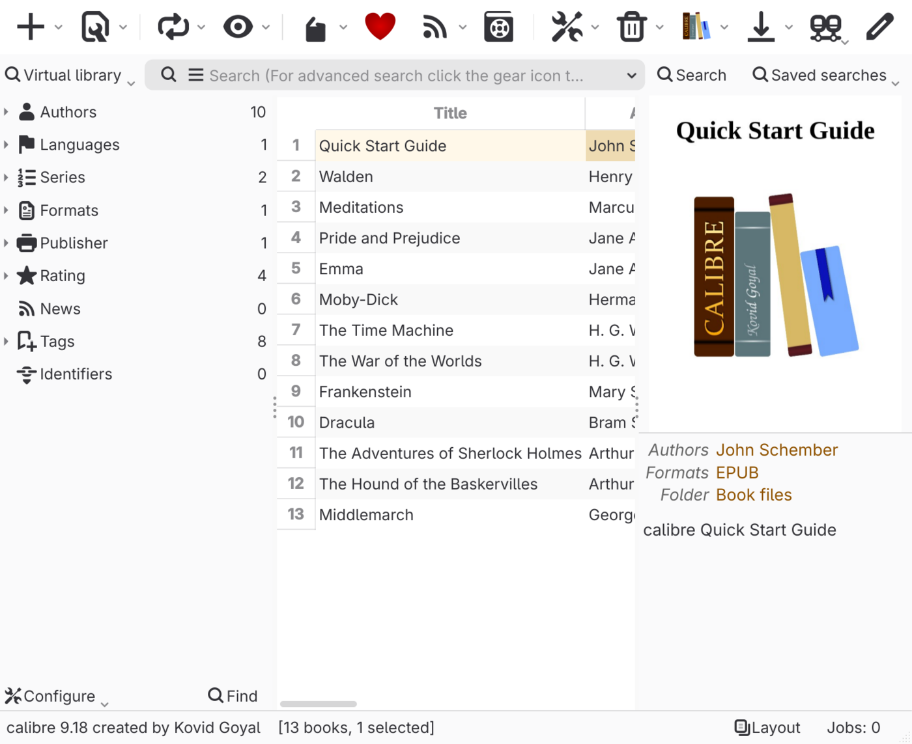
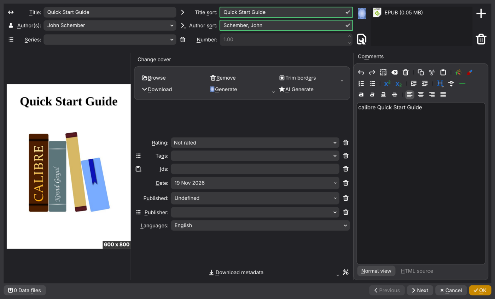
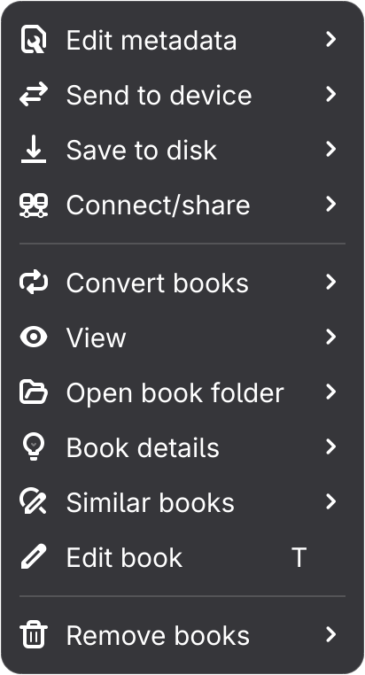
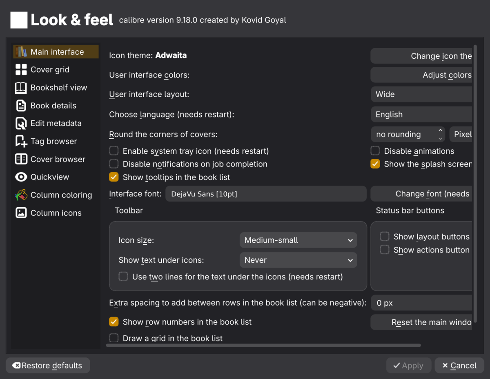

# Adwaita for calibre

A [calibre](https://calibre-ebook.com) plugin that makes calibre look like a native GNOME app.

| Before | After |
|---|---|
|  |  |

## What it does

- **Colours.** libadwaita's palette (GNOME 49): window, view, headerbar and popover surfaces,
  foreground and border opacities. calibre follows the GNOME light/dark setting live, as it
  already does with its own palette.
- **Your accent colour.** Read from the desktop's Settings portal, so it matches whatever accent
  you picked in GNOME Settings, and changes when you change it. Falls back to blue.
- **Controls.** The toolbar is styled as a headerbar. Buttons and entries get 9px corners,
  and the dialog's default button gets the accent ("suggested action"). Also restyled: check
  boxes and radio buttons, rounded menus and popups, view-switcher tabs, thin scroll bars
  without arrows, group boxes as cards, flat column headers.
- **Font.** Uses the GNOME interface font (`Adwaita Sans 11` by default) unless you have set a
  font in calibre's Preferences.
- **Icons (optional).** GNOME's Adwaita symbolic icons for the toolbar, menus and tag browser,
  in light and dark variants. 186 of calibre's icons are mapped. Format icons, device pictures,
  logos and other pictures whose colour carries meaning stay calibre's own.

| Edit metadata | Context menu | Preferences |
|---|---|---|
|  |  |  |

## Install

1. Download `AdwaitaForCalibre-<version>.zip` from the
   [releases](https://github.com/CR0CKER/adwaita-for-calibre/releases).
2. calibre → Preferences → Plugins → **Load plugin from file** → choose the zip → restart calibre.
3. Optional, for the icons: Preferences → Plugins → *Adwaita for calibre* → **Customize plugin**
   → **Use Adwaita icons**, then restart. Your previous icon theme is kept and **Restore
   previous icons** brings it back.

Tip: Adwaita's symbolic icons are drawn for small sizes. Preferences → Look & feel → Main
interface → Toolbar → Icon size *Small* matches GNOME apps most closely.

### Uninstall

Remove the plugin in Preferences → Plugins and restart. If you installed the icons, restore
your previous icons first (or pick another theme in Look & feel → *Change icon theme*).

## Requirements and limits

- Linux, calibre 9.x with its own Qt style (the default). Tested on calibre 9.18 (Flathub) on
  Fedora 43 / GNOME 49. Reading the accent and the font needs `xdg-desktop-portal`, which every
  GNOME desktop and the Flatpak sandbox provide.
- calibre's own colour palette settings (Look & feel → *Adjust colors*) have no effect while the
  plugin is active.
- The title bar and the toolbar remain two separate bars: Qt widgets cannot merge them into a
  single GTK headerbar. The title bar uses Qt's own Adwaita-style Wayland decorations.
- The e-book viewer and the book editor run as separate programs that do not load interface
  plugins, so they keep calibre's look.
- Some calibre widgets set their own colours, such as the green check on valid sort fields;
  those are left alone on purpose.

## How it works

calibre rebuilds its palette and stylesheet whenever the colour scheme changes
(`calibre/gui2/palette.py`, `PaletteManager`). The plugin replaces the two palette factories and
appends its stylesheet each time that happens. There is no native Qt Adwaita style to switch to:
calibre's Flathub build bundles its own Qt, so system Qt styles cannot load. The icon set is
compiled into calibre's own user icon-theme slot. See [docs/development.md](docs/development.md).

## License

GPL-3.0, see [LICENSE](LICENSE). The icon set and the indicator images are GNOME's Adwaita
symbolic icons from adwaita-icon-theme 49.0 (LGPL-3.0-only or CC-BY-SA-3.0, GNOME Project),
recoloured; the advanced-search cog is GNOME Settings' symbolic icon (gnome-control-center 49,
CC0-1.0); nine symbols GNOME has no icon for (books, tag, ++, −−, text colour, superscript, subscript,
heading, horizontal rule) were drawn for this plugin in the same style (GPL-3.0). Colour values are taken from libadwaita (LGPL-2.1-or-later).

GNOME is a trademark of the GNOME Foundation. This plugin is designed for use with GNOME but is
not affiliated with or endorsed by the GNOME Foundation or the GNOME Project, nor by calibre.

Developed with the assistance of Claude Code.
