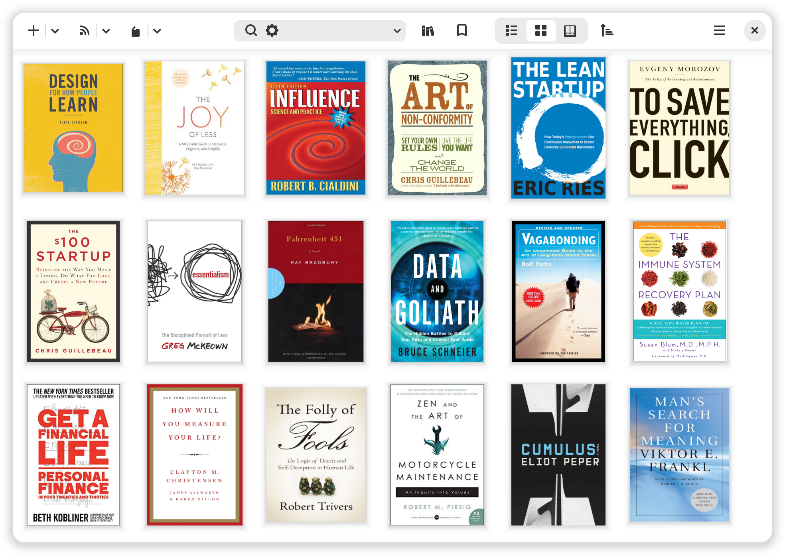
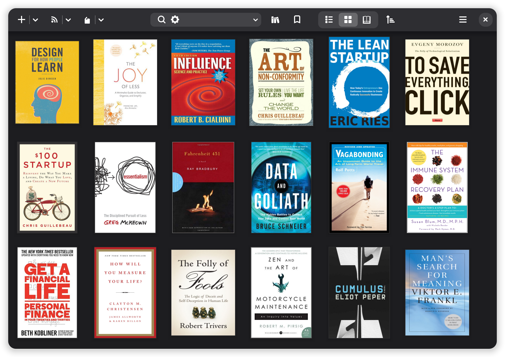

# Adwaita for calibre

Last updated: 2026-11-25 08:36 PM CET

[](https://github.com/CR0CKER/adwaita-for-calibre/actions/workflows/ci.yml)
[](LICENSE)

A [calibre](https://calibre-ebook.com) plugin that makes calibre look and feel like a native GNOME
app: libadwaita's colours, controls and layout, GNOME's symbolic icons, and a single header bar.

| Light | Dark |
|---|---|
|  |  |

## What it changes

**Colours that follow GNOME.** libadwaita's palette (GNOME 49), switching live with the system's
light/dark setting, in your GNOME accent colour (read from the desktop's Settings portal; it
changes when you change it). The GNOME interface font is used unless you set one in calibre.

**One header bar.** The toolbar and the search row become a single GNOME header bar: your actions
on the left, a centred search field with Virtual library and saved searches, a List · Grid ·
Bookshelf view switcher with a cover-browser toggle beside it, and a ☰ main menu (Preferences,
Layout, all actions, Help, Restart). Sidebar
toggles at either end show and hide the tag browser and the book details pane, which slide in
and out (Shift+Alt+T and Shift+Alt+D do the same). Split
buttons look like GNOME's split buttons, "Small" toolbar icons are GNOME's 16 px, and
Preferences can be removed from the toolbar since it lives in the main menu. Actions that don't
fit in the header go into a ⋯ button after the last one that does.

**GNOME controls throughout.** Rounded buttons and entries with the accent on the default button,
check boxes, radio buttons, menus and popovers with libadwaita's outline and shadow, view-switcher
tabs, overlay scroll bars that fade out, flat column headers, cards for group boxes.

**A three-pane layout.** The tag browser and the book details pane share the book area's colour
and are set off from it by hairlines instead of splitter grips. The tag browser gets rounded rows,
GNOME expanders and an action bar for Configure / Find. Shadows appear under the header bar only
while content is scrolled beneath it.

**No status bar.** Like other GNOME apps, calibre's status bar is hidden; running jobs (news
downloads, conversions) show as GNOME's spinner in the header bar, which opens the Jobs list.
Preferences → Interface → *Show status bar* (in the ☰ menu) or Ctrl+Shift+S brings the bar back
(remembered across restarts); it then shows just the book count
and selection, with a shadow above it while content is scrolled beneath. The Layout button moves
to the main menu either way.

**Books.** Covers are drawn as cards with a soft shadow, so white covers stand out on a white
grid. In the book details panel the cover just appears, without calibre's zoom-in. The bookshelf view uses flat Adwaita colours instead of wood.

**Dialogs and popups.** The Layout popup is a popover. Edit metadata becomes one calm surface: a
top-aligned form, consistent icon sizes, a cover card, card-style formats list and comments
editor, quiet per-row buttons that light up on hover, and the sort fields' state as a small green
or amber icon instead of a coloured outline.

**The e-book viewer** (optional, on by default): Adwaita colours for its panels and for the
"System" reading colour scheme, which follows light/dark and the accent.

**Icons (optional).** GNOME's Adwaita symbolic icons for the toolbar, menus, tag browser and
dialogs, in light and dark variants: 186 of calibre's icons. Nine symbols GNOME has no icon for
were drawn in the same style. File-format icons, logos and status dots stay calibre's own.

**Integrated title bar (optional, experimental).** The header bar becomes the window's title bar,
with GNOME window buttons, rounded corners and shadow; drag it to move, resize from the edges,
snapping and tiling work. Needs calibre on X11 or XWayland, see below.

## Install

1. Download `AdwaitaForCalibre-<version>.zip` from the
   [releases](https://github.com/CR0CKER/adwaita-for-calibre/releases).
2. calibre → Preferences → Plugins → **Load plugin from file** → choose the zip → restart calibre.
3. Optional: Preferences → Plugins → *Adwaita for calibre* → **Customize plugin**:
   - **Use Adwaita icons** installs the icon set (your current icon theme is kept; **Restore
     previous icons** brings it back);
   - **Integrated title bar** (needs X11/XWayland);
   - **Apply to the e-book viewer** (on by default).

   Restart calibre after changing these.

### Integrated title bar: run calibre on XWayland

On Wayland, Qt cannot tell GNOME where a frameless window's real edge is, so the plugin leaves the
title bar alone there. On XWayland it can, and GNOME then also draws calibre's ordinary title
bar with the correct font. For the Flathub build:

```
flatpak override --user --env=QT_QPA_PLATFORM=xcb --socket=x11 --nosocket=fallback-x11 com.calibre_ebook.calibre
```

`--nosocket=fallback-x11` is needed: with the manifest's `fallback-x11`, Flatpak withholds the X11
socket whenever Wayland is available. Undo with
`flatpak override --user --reset com.calibre_ebook.calibre` (this also removes any other
overrides you set for calibre). For a non-Flatpak calibre, start it with `QT_QPA_PLATFORM=xcb`.

### Uninstall

1. Preferences → Plugins → *Adwaita for calibre* → **Customize plugin** → **Restore calibre's
   look**. This puts back your previous icons, calibre's own colours and the e-book viewer's
   previous colour scheme (close the viewer first).
2. Remove the plugin in Preferences → Plugins and restart calibre.

## Requirements and limits

- Linux, calibre 9 with its own Qt style (the default). Tested on calibre 9.18 (Flathub) on
  Fedora 43 / GNOME 49, dark and light. The accent and font come from `xdg-desktop-portal`,
  which GNOME and the Flatpak sandbox provide.
- calibre's own colour palette setting (Look & feel → *Adjust colors*) has no effect while the
  plugin is active.
- On its first run the plugin changes three calibre settings once, so the header bar is GNOME's
  size: Look & feel → Toolbar to *Small* icons without text, and Searching → *Show text in the
  buttons of the search bar* off. You can change them back at any time, and the plugin won't
  change them again; Customize plugin → **Restore calibre's look** puts back what you had.
- When a device connects, calibre's sweep across the toolbar is off. With calibre's classic
  menu bar switched on (Toolbars & menus → *The menubar*), it sits above the header bar.
- Hidden panes (cover browser, Quickview, side panels) take no space, so they can no longer be
  dragged out from the window edge; open them from the Layout button or their shortcut.
- Double-clicking the integrated title bar does not maximize the window (the window manager owns
  the pointer after the first click). Use Super+↑ or drag to the top edge.
- The e-book viewer's in-page scroll bar keeps calibre's look: the viewer's page files cannot be
  overridden. It can be switched off in the viewer's Preferences → Scrolling behavior.
- The book editor and other separate calibre programs keep calibre's look.
- With the status bar hidden, the book count and selection, device messages and calibre's update
  notice are not shown; switch it on in Preferences → Interface → *Show status bar* (Ctrl+Shift+S)
  if you want them. If you used the
  *Hide Statusbar* plugin, it is no longer needed.
- calibre's *Toggle search bar* shortcut (Shift+Alt+F) hides the whole header bar, since the
  header bar is calibre's search bar; press it again to bring it back.

## Troubleshooting

| Symptom | Cause and fix |
|---|---|
| A black frame around the window with the integrated title bar | calibre is on Wayland, or the window was created before the plugin could make it translucent. Check the XWayland override above (`flatpak override --user --show com.calibre_ebook.calibre`) and restart calibre. |
| `could not connect to display` / calibre does not start after the override | The X11 socket is withheld: the override needs `--nosocket=fallback-x11` as well as `--socket=x11`. |
| The integrated title bar setting does nothing | It is ignored on native Wayland by design; see *Integrated title bar* above. |
| Icons did not change | Install them from Customize plugin → **Use Adwaita icons**, then restart calibre. |
| The accent colour does not follow GNOME | The accent is read from `xdg-desktop-portal`; make sure it is running, then restart calibre. |
| Something looks broken after a calibre update | The plugin patches calibre internals and is tested on calibre 9.18. Disable it to compare: `flatpak run --command=calibre-customize com.calibre_ebook.calibre --disable-plugin "Adwaita for calibre"`, and please open an issue. |

For a diagnostic log, start calibre with `ADWAITA_CALIBRE_DEBUG=1` set
(`flatpak run --env=ADWAITA_CALIBRE_DEBUG=1 com.calibre_ebook.calibre`) and read the terminal
output; lines start with `adwaita-for-calibre:`.

## How it works

calibre rebuilds its palette and stylesheet whenever the colour scheme changes
(`calibre/gui2/palette.py`). The plugin replaces the two palette factories and appends its
stylesheet each time that happens, and patches a handful of calibre's widgets and delegates where
a stylesheet cannot reach. There is no native Qt Adwaita style to switch to: calibre's Flathub
build bundles its own Qt, so system Qt styles cannot load. See
[docs/development.md](docs/development.md) for every hook and the development loop.

## License

GPL-3.0, see [LICENSE](LICENSE). The icon set and indicator images are GNOME's Adwaita symbolic
icons from adwaita-icon-theme 49.0 (LGPL-3.0-only or CC-BY-SA-3.0, GNOME Project), recoloured;
the search field's cog is GNOME Settings' symbolic icon (gnome-control-center 49, CC0-1.0); ten
symbols GNOME has no icon for (books, tag, ++, −−, text colour, superscript, subscript, heading,
horizontal rule, the AI sparkle) and the cover-browser toggle's icon were drawn for this plugin in the same style
(GPL-3.0). Colour values are taken
from libadwaita (LGPL-2.1-or-later).

GNOME is a trademark of the GNOME Foundation. This plugin is designed for use with GNOME but is
not affiliated with or endorsed by the GNOME Foundation or the GNOME Project, nor by calibre.

